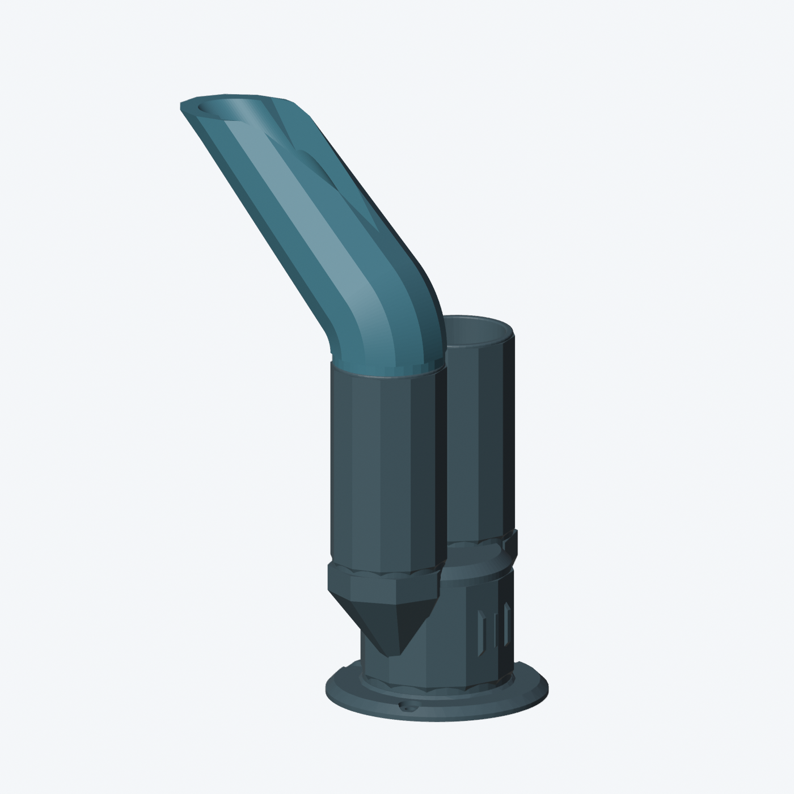

# Suporte — revisão facetada do completo.3mf

Revisão baseada no arquivo original enviado pelo usuário, mantendo **duas peças**: corpo com dois tubos e extensão curva. A extensão passa a 45° e os exteriores recebem faces planas. O encaixe original é preservado; as rampas e a face de apoio da ponta foram ajustadas para a impressão na A1.

- [Baixar projeto 3MF](projeto-jetski/duas-pecas/completo_duas_pecas_facetado.3mf)
- [Baixar os dois STL](projeto-jetski/duas-pecas/STL_duas_pecas.zip)
- [Mudanças, perfil e validação](projeto-jetski/duas-pecas/LEIA-ME.md)

Perfil: A1, PETG, bico 0,4 mm, camada 0,20 mm, **3 paredes e 15% gyroid**. Use a orientação de impressão salva no 3MF.

**Protótipo sem validação física de encaixe, resistência ou vedação.** As revisões anteriores foram preservadas no histórico e nas respectivas pastas; a V3 anterior com várias peças não corresponde a esta revisão do arquivo original.
