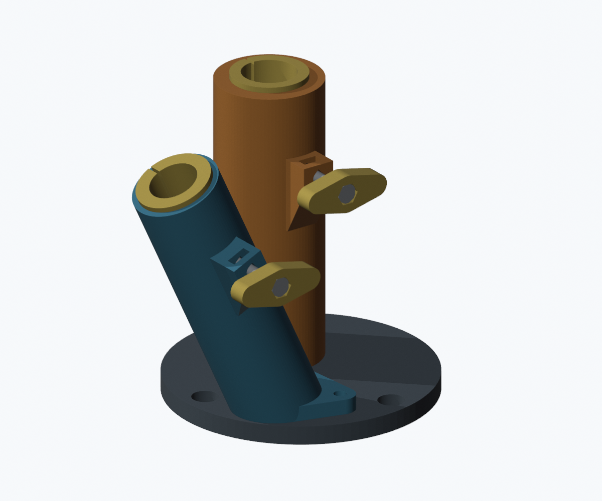

# Suporte para uma vara e um guarda-sol — protótipo V2

A revisão atual tem base somente circular de 140 mm, um porta-varas a 25 graus da vertical e duas borboletas de aperto manual com roscas M6 metálicas.

- [Baixar 3MF A1/PETG V2](https://raw.githubusercontent.com/otal3d-bot/otalrepositorio1/main/projeto-jetski/v2/Jetski_A1_PETG_V2_CIRCULAR_25GRAUS.3mf)
- [Baixar pacote completo V2](https://raw.githubusercontent.com/otal3d-bot/otalrepositorio1/main/projeto-jetski/v2/Jetski_PROTOTIPO_V2_completo.zip)
- [Instruções e ferragens](projeto-jetski/v2/LEIA-ME.md)

Fatiamento verificado no Bambu Studio: A1, bico 0,4 mm, PETG, sem suportes, uma mesa, estimativa de 24 h 55 min e 507 g.

**Protótipo sem validação física de encaixe, resistência ou vedação. Não certificado para venda nem compatibilidade universal.** A versão V1 preservada no diretório anterior está superada por esta revisão.
