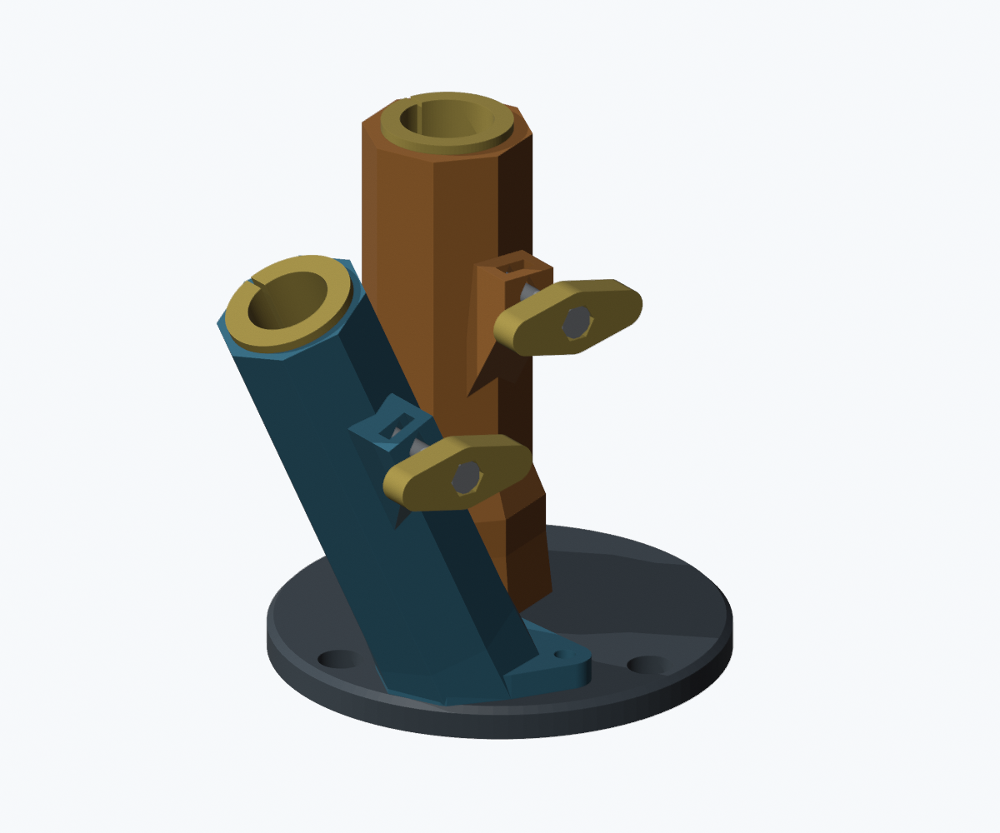

# Suporte para uma vara e um guarda-sol — protótipo V3

A revisão atual altera os STL para alojamentos octogonais com nervuras e rampas para impressão sem suportes. Mantém a base circular de 140 mm, um porta-varas a 25° da vertical e duas borboletas de aperto manual com roscas M6 metálicas.

- [Projeto 3MF A1/PETG V3](projeto-jetski/v3/Jetski_A1_PETG_V3_FACETADO_25GRAUS.3mf)
- [Pacote completo V3](projeto-jetski/v3/Jetski_PROTOTIPO_V3_completo.zip)
- [STL individuais](projeto-jetski/v3/stl/)
- [Mudanças, validação e instruções](projeto-jetski/v3/LEIA-ME.md)

Fatiamento A1, bico 0,4 mm, PETG, camada 0,24 mm, **3 paredes e 15% gyroid**: estimativa de **17 h 23 min e 332,95 g**, sem suportes, em uma mesa. As nove malhas passaram na análise de fechamento e de faces inferiores acima de 45° fora da mesa. A geometria facetada e os módulos separados diferem visualmente da referência fotográfica.

**Protótipo sem validação física de encaixe, resistência ou vedação. Não certificado para venda nem compatibilidade universal.** As revisões V1 e V2 foram preservadas.
